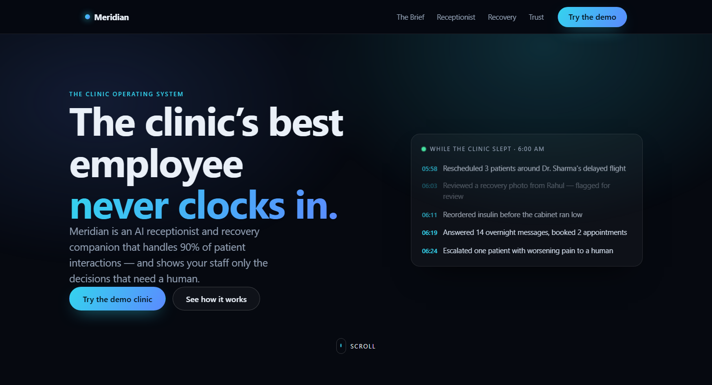
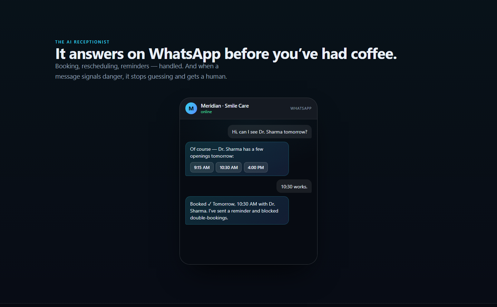

# Smile Care AI

**An AI receptionist and recovery companion for clinics.** It answers patients, books and reschedules appointments, follows up after treatment, catches emergencies, and hands off to staff when a human should decide.



The codebase is called **HealFlow**; the product shown to clinics is **Meridian**.

## Features

- **AI receptionist.** A Claude tool-use agent books, cancels and reschedules appointments, checks doctor availability, quotes fees and answers clinic FAQs. Double booking is blocked by a database constraint, not just app logic.
- **Works without an API key.** With no `ANTHROPIC_API_KEY` set, a deterministic router still handles booking, clinic info, medications, queue status and FAQs.
- **Emergency detection that can't be talked around.** A rule layer runs *before* any model call. Chest pain, breathing trouble, stroke signs, heavy bleeding, suicidal ideation and similar messages trigger the emergency script, raise an escalation and flag the patient as high priority.
- **Staff take over at any moment.** The reception workspace (`/reception`) shows every conversation live over WebSocket. Staff can take over a thread, draft a reply with "Suggest reply", and hand control back to the AI.
- **Morning Brief.** Ranks the patient panel each morning and shows staff only the patients who need a human, with the reason for each.
- **Recovery follow-ups.** Daily check-ins with pain scores, medication reminders with nudges, appointment reminders (24 h and 2 h), feedback requests and no-show marking, all run by Celery beat.
- **Six languages.** Detects English, Hindi, Kannada, Tamil, Telugu and Malayalam and replies in the same language.
- **Answers only from approved content.** FAQs come from the clinic's own knowledge base, never improvised medical advice. Prescriptions, diagnosis and consent can never run on their own.
- **Privacy enforced in code and tests.** Patients can read only their own conversation; staff endpoints require a staff role; role changes are not exposed over the API.
- **WhatsApp ready.** A Meta Cloud API webhook is built in. Add a WhatsApp Business number and tokens to switch it on.



## Tech stack

| Layer | Tools |
|---|---|
| Backend | Python 3.12, FastAPI, SQLAlchemy 2, Alembic, Pydantic v2 |
| AI | Anthropic Claude (tool use), pgvector for embeddings |
| Jobs | Celery + Redis (worker and beat) |
| Database | PostgreSQL with pgvector |
| Frontend | Next.js 15 (App Router), React 19, TypeScript |
| Infra | Docker Compose, Nginx (TLS, rate limits, security headers), Terraform (AWS ECR) |
| Observability | Prometheus, Grafana, OpenTelemetry |
| CI | GitHub Actions: Ruff, mypy, pytest, ESLint, type check, Trivy image scan |

## Project layout

```
healflow-backend/    FastAPI app, agent tools, Celery tasks, Alembic migrations, tests
healflow-frontend/   Next.js app: patient chat, reception workspace, Morning Brief, landing page
healflow-devops/     Docker Compose, Dockerfiles, Nginx, monitoring, Terraform, scripts
docs/                Receptionist guide and Meridian architecture docs
```

## Setup

You need Docker 24+ with Compose v2, and Git.

```bash
git clone https://github.com/mohnishm12/Smile-care-ai.git
cd Smile-care-ai

# 1. Environment
cp healflow-devops/.env.example healflow-devops/.env
# Edit healflow-devops/.env: set JWT_SECRET_KEY and ENCRYPTION_KEY (openssl rand -hex 32).
# Optional: set ANTHROPIC_API_KEY to use Claude instead of the built-in router.

# 2. Local TLS certificates (Nginx needs them to start)
bash healflow-devops/scripts/generate-dev-certs.sh

# 3. Start everything (migrations run automatically)
docker compose -f healflow-devops/docker-compose.yml up -d --build

# 4. Check it is up
curl -k https://localhost/health
```

Then open:

- `https://localhost/home` for the landing page
- `https://localhost/chat` to talk to the receptionist as a patient
- `https://localhost/reception` for the staff workspace (create a staff login with `healflow-devops/scripts/create-staff-user.sh`)

To work on the frontend alone: `cd healflow-frontend && npm install && npm run dev`.

## Documentation

- [Receptionist guide](docs/RECEPTIONIST.md): what is live, how takeover works, the demo flow
- [DevOps guide](healflow-devops/README.md): services, CI/CD, monitoring, production deployment
- [Architecture](docs/MERIDIAN_ARCHITECTURE.md), [Product principles](docs/MERIDIAN_CONSTITUTION.md), [Glossary](docs/MERIDIAN_LANGUAGE.md)

## License

[MIT](LICENSE)
